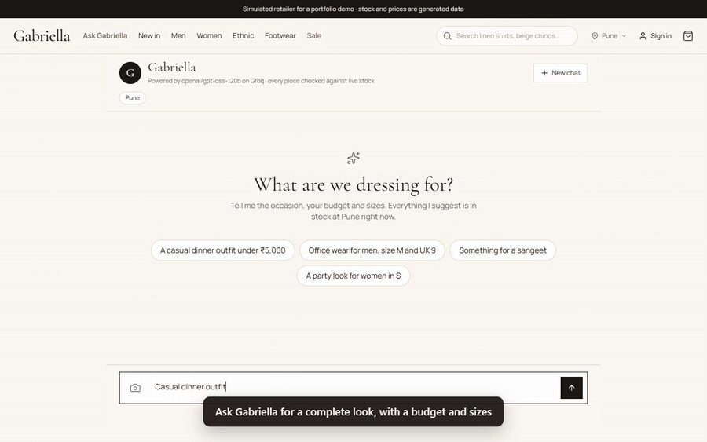
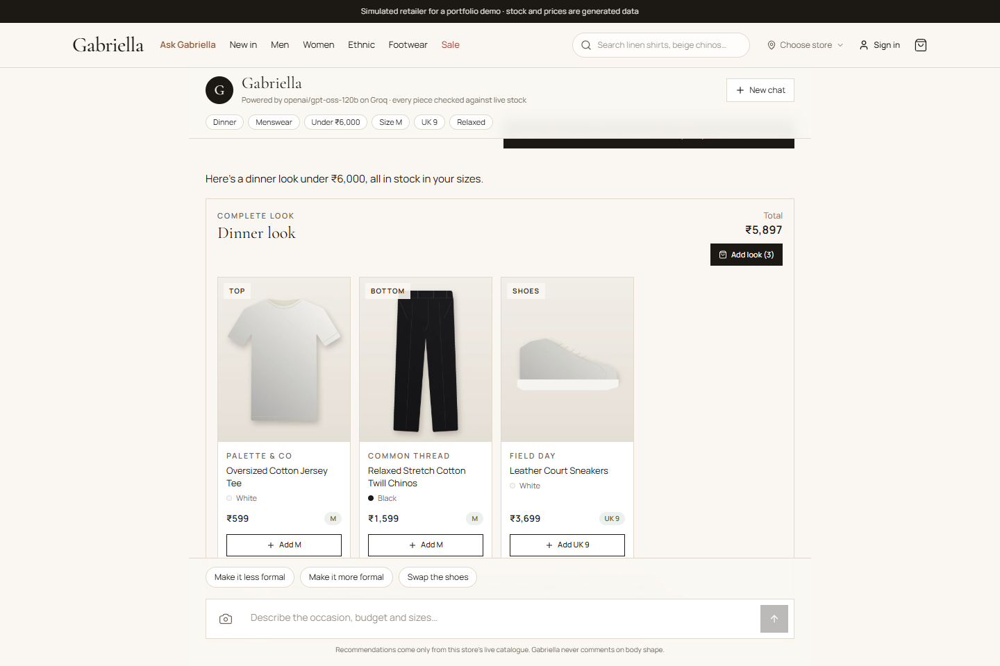
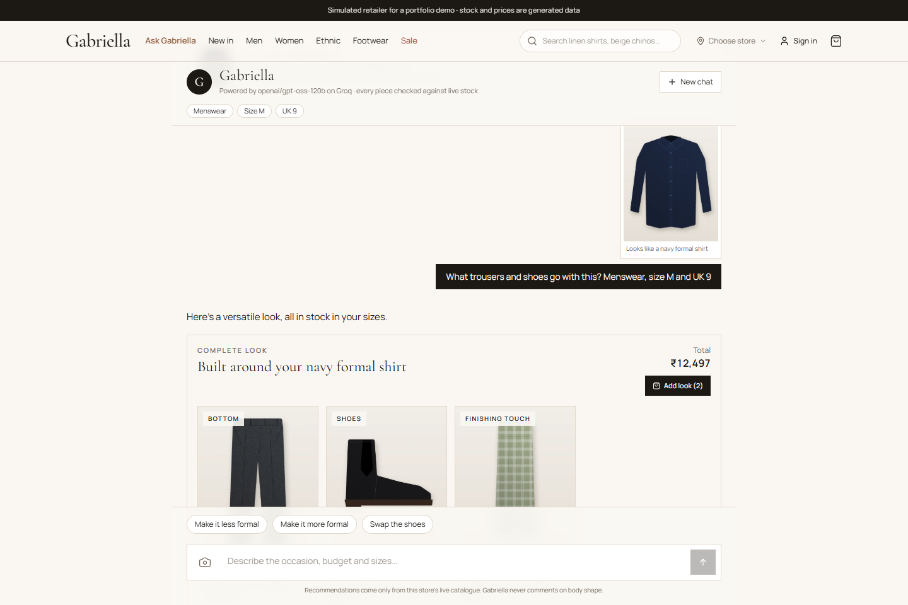
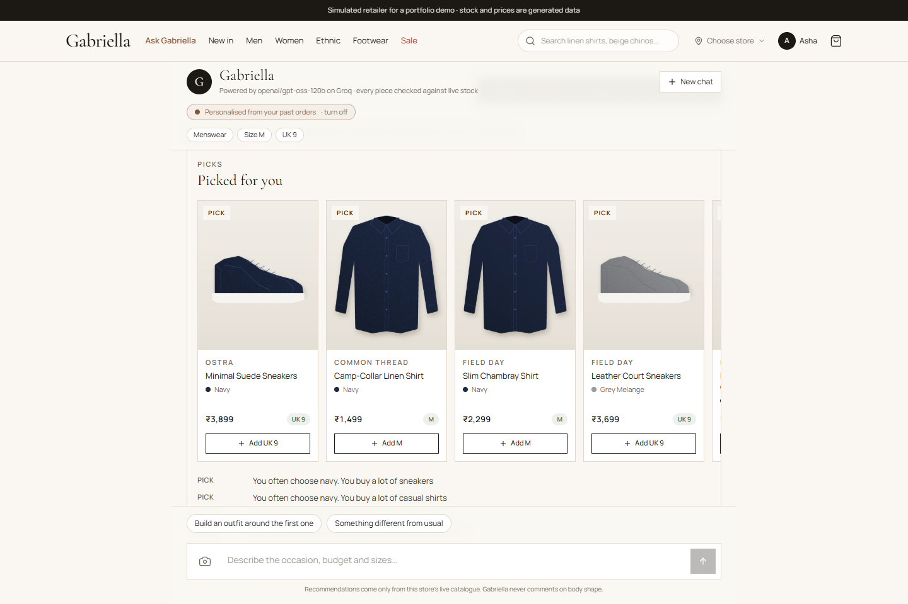
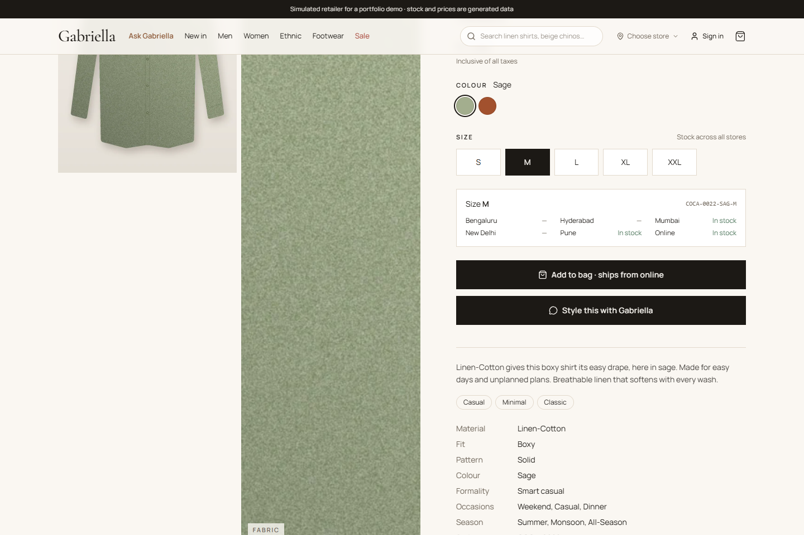
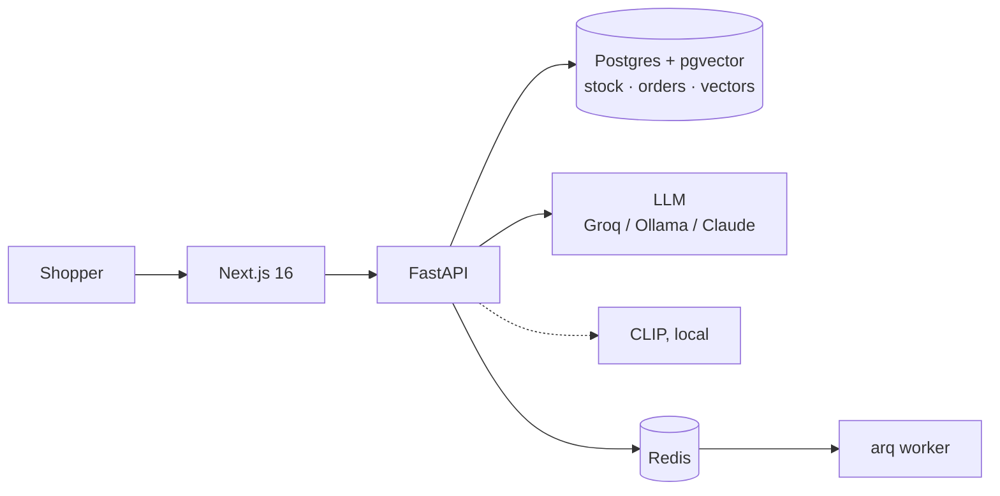

# Gabriella

**An AI fashion stylist that only recommends what's actually on the shelf.**

Gabriella is a chat-based sales assistant for a simulated Indian multi-brand fashion retailer. Ask for "a casual dinner outfit under ₹6,000 in M and UK 9" and she builds a complete look. Every piece is a real catalogue product, in your size, in stock at your store, and within budget, and the server checks all of that before you see it. She also styles around a photo of your own clothes, learns from your past orders, and lets you buy the whole look in one click.

It runs entirely on **free and open-source models**: open-weight LLMs on Groq or locally on Ollama, and CLIP embeddings on the CPU. It still works with no model at all.

### ▶ [Watch the 2-minute demo](docs/media/gabriella-demo.mp4)

[](docs/media/gabriella-demo.mp4)

<sub>The demo covers search → a complete outfit → refining it → an honest "not possible" → styling a photo of your own shirt → personalised picks → buying the whole look. It was recorded automatically from the running app with <code>scripts/record_demo.py</code>.</sub>

<table>
<tr>
<td width="25%"><br><sub><b>Complete outfits</b>: in stock, in your size, within budget</sub></td>
<td width="25%"><br><sub><b>Photo of your own shirt</b>: identified, then styled around</sub></td>
<td width="25%"><br><sub><b>Personalised</b>: from past orders, never re-suggesting owned items</sub></td>
<td width="25%"><br><sub><b>Live stock</b>: per size, per store</sub></td>
</tr>
</table>

> All brands, products, stores, prices and stock levels are generated. No real retailer is affiliated.

## What it does

| | |
| --- | --- |
| 🧥 **Complete outfits** | Top, bottom, shoes and an optional accessory, chosen together for formality, occasion and colour harmony under the *total* budget |
| 📦 **Inventory-aware** | Stock is tracked per size per store. Recommendations, substitutes and "do you have this in M?" all answer for *your* store, and point to other stores when your size is out |
| ✅ **Grounded by design** | A server-side validator rejects any product the model didn't retrieve, any size not in stock and any outfit over budget, then repairs or drops it. Hallucinated products can't reach the screen |
| 🔎 **Hybrid search** | Postgres full-text + CLIP text vectors + CLIP image vectors, fused with Reciprocal Rank Fusion, after hard SQL filters for size, stock, price and colour |
| 📷 **"What goes with this?"** | Upload a photo of your own garment. Gabriella identifies it (CLIP zero-shot plus a nearest-neighbour vote, with colour extraction), then builds an outfit around it or finds similar pieces |
| 💡 **Personalisation** | A compact style profile built from past orders (sizes, colours, price band) fills in gaps and ranks picks. It never re-suggests owned items, and it can be switched off per account or per chat |
| 🛍️ **Cart and checkout** | Add a single size or a whole look. Checkout decrements stock in one transaction using row locks |
| 🔁 **Conversational** | "Make it less formal", "swap the shoes", "keep it under 7000" refine the current look; "start fresh" clears it |
| 📊 **Measured** | An evaluation suite replays 26 scripted conversations and independently re-checks every displayed item against the database |

## Results

From the evaluation suite (`backend/evals`, details in [docs/evaluation.md](docs/evaluation.md)). The suite runs 26 conversations covering outfits, occasions, refinements, stock, substitutes, photos, personalisation and dead ends:

<!-- EVAL-RESULTS:START -->
| | Groq · gpt-oss-120b | Rule-based (no model) |
| --- | --- | --- |
| Conversations passing all checks | 23 / 26 ¹ | 26 / 26 |
| Displayed items that exist, at the shown price | **100%** (63 items) | **100%** (74 items) |
| Displayed items in stock in the shown size at the store | **100%** | **100%** |
| Turns answered by the model (rest: rate-limited → rule-based) | 93% | – |
| Turn latency p50 / p95 | 2.1 s / 8.7 s | 0.14 s / 0.32 s |
| Tokens per turn | ≈ 2,000 | 0 |

¹ Two misses were over-literal checks ("out of stock" vs "sold out"), since relaxed to accept paraphrases. The third, ignoring "start fresh", is fixed: a reset now bypasses the model. A later run with Groq's daily token quota used up still passed **26/26**, because every rate-limited turn was answered by the rule-based stylist ([report](backend/evals/reports/llm-quota-exhausted.md)).

| Retrieval and vision | |
| --- | --- |
| Search precision@5, hybrid vs keyword-only | **0.91** vs 0.84 |
| Search latency p50 / p95 | 51 ms / 85 ms |
| Photo → outfit slot (top, bottom, shoes…) | 96.7% |
| Photo → exact category (of 30) | 75.0% (CLIP zero-shot alone: 61.7%) |
| Photo → colour family | 60.0% |
<!-- EVAL-RESULTS:END -->

## Quick start

You need Docker. A free [Groq API key](https://console.groq.com/keys) is optional but recommended.

```bash
git clone <this repo> gabriella && cd gabriella
cp .env.example .env          # then set GROQ_API_KEY=… (optional)
docker compose up -d --build
```

- **The first build** downloads the CLIP models (about 0.6 GB).
- **The first boot** migrates the database, seeds 500 products across 6 stores, and renders their images (1–2 minutes).
- **The worker** then embeds the catalogue (about a minute).

Then open:

| | |
| --- | --- |
| Shop and chat | http://localhost:3000 · chat at http://localhost:3000/chat |
| API docs (OpenAPI) | http://localhost:8010/docs |
| Metrics | http://localhost:8010/metrics |

**Demo accounts** (local only, configurable in `.env`):

| Role | Email | Password |
| --- | --- | --- |
| Shopper with order history (Pune) | `demo@gabriella.example` | `gabriella-demo` |
| Admin (restocks) | `admin@gabriella.example` | `gabriella-admin` |

A guided walkthrough is in [docs/demo-script.md](docs/demo-script.md).

### Choosing the model

| Option | Cost | Setup |
| --- | --- | --- |
| **Groq** (default when a key is set): `openai/gpt-oss-120b` | Free key, rate-limited | `GROQ_API_KEY=` in `.env` |
| **Ollama**: fully local, e.g. `qwen2.5:7b` | Free | Install [Ollama](https://ollama.com), `ollama pull qwen2.5:7b`, set `LLM_PROVIDER=ollama` |
| Any OpenAI-compatible server (OpenRouter, vLLM, LM Studio) | Varies | `LLM_PROVIDER=openai_compatible` plus `LLM_BASE_URL`, `LLM_API_KEY`, `LLM_MODEL` |
| Anthropic Claude | Paid | `ANTHROPIC_API_KEY=` |
| None | Free | Leave keys empty: the rule-based stylist answers |

After changing `.env`, run `docker compose up -d api`. The chat header always shows which model answered. If a model call fails or hits a rate limit, the turn is answered by the rule-based stylist instead of erroring.

## How it works



On each chat turn, the steps run in this order:

1. **Constraints are parsed and carried over** (occasion, budget, sizes, gender, colours, formality), merged with the shopper's style profile if personalisation is on.
2. **The server drafts** a grounded answer with its deterministic outfit composer. The composer runs hybrid retrieval per slot under hard stock, size and budget filters, then a combinatorial search scored on formality, occasion and colour harmony.
3. **The LLM reviews and presents.** It gets the draft plus a few vetted alternatives per slot, and must answer through one structured `present_recommendation` tool call: message, products, sizes, reasons, follow-ups. With Claude, a full multi-step tool loop runs instead (search → inspect → build → present).
4. **The validator checks every item**: retrieved in this conversation, active, right size, in stock at the store, within budget. Problems are sent back to the model to fix, then repaired server-side if needed.
5. **The answer streams back** as server-sent events, with product cards re-hydrated from the database so stock is never stale.

Every turn is traced: tool calls, validation repairs, tokens and latency.

**→ Full technical tour: [docs/architecture.md](docs/architecture.md)**, covering retrieval, both agent modes, grounding, the stylist, checkout concurrency, personalisation, photo analysis and trade-offs.

## Tech stack

- **Backend:** Python 3.12, FastAPI, async SQLAlchemy 2, Alembic, Pydantic v2, arq, structlog, Prometheus client.
- **Data:** PostgreSQL 16, pgvector 0.8 (HNSW), Postgres full-text search, Redis.
- **AI:** CLIP ViT-B/32 via fastembed (ONNX); open-weight LLMs through any OpenAI-compatible API (Groq, Ollama); Anthropic SDK for Claude.
- **Frontend:** Next.js 16 (App Router, React Server Components, cache components), React 19, TypeScript, TanStack Query, Tailwind CSS.
- **Ops:** Docker Compose, uv, pnpm, Ruff, pytest (about 150 tests, including a race test for overselling).

## Local development

You need [uv](https://docs.astral.sh/uv/), Node 24 with pnpm, and Docker (for Postgres and Redis).

```bash
docker compose up -d db redis
```

```bash
cd backend
uv sync
uv run alembic upgrade head
uv run python -m seed                 # catalogue, stock for 6 stores, images, demo order history
uv run python -m app.workers.embed    # CLIP vectors for every product
uv run uvicorn app.main:app --port 8010 --reload
```

```bash
cd backend && uv run arq app.workers.worker.WorkerSettings   # optional locally: embedding sync, upload expiry
```

```bash
cd frontend && pnpm install && pnpm dev   # http://localhost:3000, proxies /api and /media to :8010
```

Rebuild the catalogue from scratch (asks first; wipes products, stock, orders and users):

```bash
cd backend && uv run python -m seed --reset
```

### Tests, checks and evals

```bash
cd backend && uv run pytest && uv run ruff check .
```

```bash
cd frontend && pnpm lint && pnpm exec tsc --noEmit
```

```bash
cd backend && uv run python -m evals.run               # rule-based stylist (fast, free)
```

```bash
cd backend && uv run python -m evals.run --mode llm    # the configured model; paced for free-tier limits
```

- **Tests** run against a separate `gabriella_test` database. They migrate it down and up each run, so the migrations get tested too.
- **No real models in tests:** a deterministic hashing embedder stands in for CLIP, and scripted models stand in for the LLM.
- **Evals** write `backend/evals/reports/<mode>-latest.md` and `.json`.

## Repository layout

```
backend/
  app/
    agent/      tools, tool loop, pipeline mode, validator + repair, rule-based stylist, providers
    retrieval/  query parser, hybrid search, similar products
    vision/     photo upload safety, garment recognition, colour extraction
    services/   inventory, cart and checkout, style profiles
    api/        routes: auth, catalogue, chat (SSE), commerce, admin, health
    db/         SQLAlchemy models
    ml/         embedding backends (CLIP, hashing for tests)
    workers/    arq worker: embedding sync, upload purge
  alembic/      migrations
  seed/         catalogue generator, image renderer, demo order history
  evals/        evaluation cases, runner, reports
  tests/
frontend/src/
  app/          /, /shop, /product/[slug], /chat, /bag, /orders, /account, /login, /signup
  components/   chat UI, product cards, purchase panel, …
  lib/          API client, hooks
docs/           architecture, evaluation, deployment, demo script
```

## Deploying

The simplest public deployment is the same Docker Compose stack on a small VM behind Caddy for HTTPS. [docs/deployment.md](docs/deployment.md) covers it step by step, along with a managed-services alternative (Vercel, Render/Fly, Neon, Upstash) and a production checklist.

## Limitations

- **Simulated catalogue:** generated products with rendered flat-lay images. Real phone photos, with people and busy backgrounds, will be recognised less accurately than the eval numbers suggest.
- **Colour from photos** is the weakest signal (about 60% on colour family), especially light garments on light backgrounds. The chat shows the guess and its confidence, so a wrong read is visible.
- **Free-tier limits:** Groq's free tier allows 8,000 tokens a minute and 200,000 a day for `gpt-oss-120b`. Pipeline mode keeps each turn to about 2,000 tokens, so that is roughly 80–100 model-answered turns a day. Beyond that, the rule-based stylist answers, with the same grounding guarantees.
- **Payments are simulated.**
