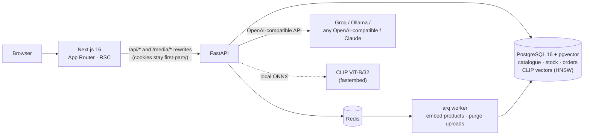
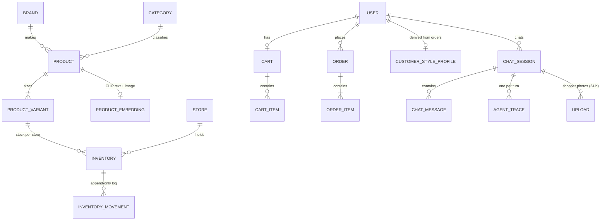

# How Gabriella works

This is the technical tour. For setup, see the [README](../README.md).

- [System overview](#system-overview)
- [Data model](#data-model)
- [Hybrid retrieval](#hybrid-retrieval)
- [The agent](#the-agent)
- [Grounding: nothing reaches the shopper unchecked](#grounding-nothing-reaches-the-shopper-unchecked)
- [The rule-based stylist](#the-rule-based-stylist)
- [Cart and checkout](#cart-and-checkout)
- [Personalisation](#personalisation)
- [Photos of the shopper's own clothes](#photos-of-the-shoppers-own-clothes)
- [Observability](#observability)
- [Design decisions and trade-offs](#design-decisions-and-trade-offs)

## System overview

| Layer | Choice | Why |
| --- | --- | --- |
| API | FastAPI, async SQLAlchemy 2, Pydantic v2 | Typed end to end; the same Pydantic models validate HTTP bodies and LLM tool calls |
| Database | PostgreSQL 16 + pgvector 0.8 | One store for stock, orders, full-text and vectors, so filtering and ranking happen in one query, transactionally |
| Embeddings | CLIP ViT-B/32 through fastembed (ONNX, CPU) | Free, offline, and multimodal: one vector space for text queries, product photos and shopper photos |
| LLM | Groq (`openai/gpt-oss-120b`) by default; Ollama, any OpenAI-compatible server or Claude | Free open-weight models; the provider is a setting, not a rewrite |
| Background work | arq on Redis | Embedding sync and upload expiry stay off the request path |
| Web | Next.js 16 (App Router, cache components), TanStack Query, Tailwind | Server-rendered catalogue pages, client-side chat with streaming |

## Data model

- **Stock is per variant (size) per store.** There are 6 stores (5 cities plus Online), 500 products and about 2,500 variants. A `CHECK (on_hand >= 0)` constraint backs every write, and every change is logged in an append-only `inventory_movements` table with a reason (checkout writes `sale`).
- **Prices are integers in rupees.** `mrp >= price`; "on sale" means `price < mrp`.
- **Vectors never decide availability.** `product_embeddings` is only used for ranking; price, size and stock always come from the relational tables at query time.
- **Seeded, not scraped.** `backend/seed/` generates 30 categories, 12 fictional brands, 39 colours and realistic INR prices, and deliberately leaves some sizes sold out at some stores. Each product image is rendered with Pillow from that product's own category, colour and pattern, so the picture always matches the data. That matters for image search.

## Hybrid retrieval

`GET /api/search?q=…` (`backend/app/retrieval/`):

1. **Parse the query** deterministically. "beige chinos under ₹3k in M" becomes category `chinos`, colour `beige`, price ≤ 3000 and size `M`. Occasion and style words ("office", "sangeet") are kept as **soft** signals, because hard-filtering on a handful of occasion tags hides good matches.
2. **Apply hard filters in SQL first:** active products only, plus the parsed filters. With `in_stock=true&store_id=…`, the requested size must actually be on the shelf at that store.
3. **Rank three ways within that filtered set:**
   - Postgres full-text search on a weighted `tsvector` (name > category > colour > description), maintained by a trigger, with fashion synonyms (pants → trousers, office → formal).
   - CLIP text embedding of the query vs. each product's **text** vector.
   - CLIP text embedding of the query vs. each product's **image** vector (cross-modal).
4. **Fuse** with Reciprocal Rank Fusion (k = 60), plus small boosts for matching occasion and style.
5. **Report match quality honestly:** `exact` (the shopper's words matched), `related` (only synonyms or vectors matched; the UI says "No exact matches — these are the closest pieces we have") or `none`.

pgvector runs HNSW indexes with iterative scans, so filtered vector queries still return enough rows. `explain=true` returns each hit's lexical, text and image rank. On the eval set, hybrid ranking beats keyword-only ranking on vague, vibe-style queries such as "cosy winter layer" (see [evaluation.md](evaluation.md)).

`GET /api/products/{id}/similar` finds substitutes from the same outfit slot, ranked by blended text and image similarity, with plain-language reasons ("Same fabric (linen)", "₹800 less"). It takes `size`, `store_id` and `in_stock`, which together answer "something like this in M at Pune".

## The agent

Code: `backend/app/agent/`. The model never sees the catalogue up front. It works through typed tools, and its final answer must be a structured `present_recommendation` call.

| Tool | Returns |
| --- | --- |
| `search_catalogue` | Hybrid search under hard filters. Compact product facts and the **in-stock sizes with variant IDs at the shopper's store** |
| `get_product` | Description, all sizes, stock at every store |
| `find_similar_products` | Same-slot substitutes with reasons |
| `check_variant_inventory` | Exact stock for one size, here and at other stores |
| `build_outfit` | A complete, budget-fitting, in-stock outfit from the outfit composer (see below) |
| `present_recommendation` | **The only way to answer.** A message, groups of `{product_id, variant_id, role, reason}`, updated constraints and suggested replies |

### Two execution modes

| | `tools` mode | `pipeline` mode |
| --- | --- | --- |
| Flow | The model plans freely: search → inspect → build → present, over several requests | Server drafts first (the deterministic composer), then **one** model call reviews the draft and up to 4 alternatives per slot, and presents |
| Model requests per turn | 3–8 | 1 (2–3 if it needs a fix) |
| Tokens per turn | 10k–30k | 1.5k–3k |
| Best for | Strong models with generous limits (Claude) | Free tiers with tight tokens-per-minute (Groq) and small local models (Ollama) |

`AGENT_MODE=auto` picks `tools` for Claude and `pipeline` for open models. Pipeline mode exists because the tool loop routinely hit Groq's 8,000 tokens-per-minute free-tier limit. The trade-off is that the model makes the stylistic judgement while the server does the retrieval legwork. In practice this is also more reliable for smaller models.

### Provider layer

`llm.py` and `openai_compat.py` give the loop a single internal tool-use format, and each backend translates it.

- **`OpenAICompatibleBackend`** (Groq, Ollama, OpenRouter, vLLM, LM Studio) handles the quirks of open models:
  - Lenient argument parsing: nested JSON sent as strings is decoded, and anything unparseable goes to the validator to reject.
  - `tool_choice: "required"` when the only tool on offer is `present_recommendation`.
  - Groq's `tool_use_failed` and "did not call a tool" errors are retried, up to 2 times.
  - On a rate limit with a long `retry-after`, it gives up immediately rather than making the shopper wait.
- **`AnthropicBackend`** handles Claude, with streaming, adaptive thinking and prompt caching.

If the model call fails for any reason (offline, rate-limited, malformed twice), the turn falls back to the server's draft and the trace records why. The shopper always gets an answer.

### Conversation state

- Constraints (occasion, budget, apparel and shoe size, gender, colours to use or avoid, formality) persist per session. "Make it less formal" refines the last look, and "start fresh" clears it.
- History goes back to the model as compact text that notes which product IDs were shown, so "swap the shoes" works.
- The store, the product in focus and any uploaded photo travel in the user turn. The system prompt and tool list stay byte-identical across turns, so the provider can cache them.

## Grounding: nothing reaches the shopper unchecked

Every `present_recommendation` call goes through `validator.py` before anything is shown:

- The product exists, is active, and was **returned by a tool in this conversation**. A real but never-retrieved ID is rejected, so a model can't recall IDs from training or invent plausible ones.
- The variant belongs to that product, matches the shopper's size for that slot, and is **in stock at their store**.
- Outfit totals fit the budget, and no product appears twice.

Problems go back to the model as a tool error to fix. If it still fails, `repair()` swaps each invalid item for an in-stock substitute from the same slot (never something the shopper already owns), or drops it, then trims the outfit to the budget. Product cards are **re-hydrated from the database on every read**, so reopening an old chat never shows stale prices or stock.

The evaluation suite re-checks all of this independently, against the database rather than through the validator (see [evaluation.md](evaluation.md)).

## The rule-based stylist

`fallback.py` is a complete stylist with no model. It is the default when no key is configured, the drafting step in pipeline mode, and the safety net when a model call fails.

- **Intent routing:** reset, similar to my photo, picks for me, availability, similar to this product, outfit, search, and off-topic, which gets a polite steer back to shopping.
- **Outfit composer:**
  - It builds a shortlist per slot (top, bottom or one-piece, footwear, optional accessory) using hybrid search under hard stock, size and budget filters.
  - Each candidate is scored on closeness to the target formality, occasion tags, retrieval rank and the shopper's favourite colour families.
  - It then searches every combination of the shortlists, about 5,000 at most, and scores **colour harmony** across the outfit (`styling.py`), all under the *total* budget.
- **Dress codes:** weddings, sangeets and festivals get ethnic wear. Shorts, joggers, hoodies, caps and sandals are excluded from dressed-up occasions.
- **Honest failure:** "I couldn't fit a full outfit in stock at Pune within ₹2,000. The most affordable complete look here comes to about ₹7,097." When nothing is on sale, it shows full-price matches and says so.

## Cart and checkout

`backend/app/services/commerce.py`, under `/api/cart`, `/api/checkout` and `/api/orders`:

- Add a single size, or **a whole look in one click** (`POST /cart/items/bulk`), from the chat or a product page.
- Each line records where it is fulfilled from (a store or Online). The cart shows live stock and flags lines that have since sold out.
- **Checkout is transactional:** it locks the needed inventory rows with `SELECT … FOR UPDATE`, in a fixed `(variant_id, store_id)` order to avoid deadlocks, re-checks quantities, decrements stock, writes `sale` movements and creates the order, all in one transaction. A concurrency test races 10 buyers for the last unit and asserts exactly one succeeds.
- Payment is simulated; the order gets a reference like `GB-261123-CDC7EE`.

## Personalisation

`backend/app/services/profile.py`:

- After every checkout, the shopper's orders are condensed into a **style profile**: usual apparel and shoe sizes, favourite colours and colour families, top categories, typical price band, style tags and brands, plus recently bought and returned product IDs.
- The model sees only a one-line summary ("usually buys M / UK 9; favourite colours navy, olive; typically spends ₹1,500–₹3,500 per item"), never the order history.
- Profile sizes fill in when the shopper doesn't give any. Favourite colour families nudge the ranking. **Owned items are never recommended again**, including as repair substitutes.
- "Suggest something based on what I bought" gives a *Picked for you* group: new items in their colours, categories and price band, at most two per category.
- It is used **only if both** the account-level switch and the per-chat toggle are on. "Start fresh" ignores it for that turn. The demo account is seeded with four past orders so this is visible straight away.

## Photos of the shopper's own clothes

`backend/app/vision/garment.py`, `POST /api/chat/sessions/{id}/uploads`:

1. **Safety first:**
   - JPEG, PNG or WebP only, up to 8 MB; decompression bombs are refused.
   - Images are re-encoded to a fresh WebP, so EXIF data (including GPS) is stripped.
   - Files and rows expire after 24 hours; a worker cron purges them every 30 minutes.
2. **What is it?**
   - CLIP zero-shot classification against the catalogue's own leaf categories, **blended 50/50 with a vote from the 12 visually nearest catalogue photos**.
   - On held-out catalogue photos, the blend raised exact-category accuracy from 62% to 75%; the outfit slot is right 97% of the time.
3. **What colour and pattern?**
   - The dominant non-background colour (background estimated from the border, then median-cut quantisation), snapped to the nearest catalogue colour using a perceptual distance.
   - Pattern (solid, striped, checked or printed) by zero-shot.
4. **Use it:**
   - The photo becomes a *virtual garment* that the outfit composer builds around ("What trousers and shoes go with this?").
   - Or its CLIP vector drives a visual search ("Show me similar ones").
   - The chat shows the guess and its confidence ("Looks like a navy formal shirt · 88% sure"), so a wrong read is visible, and the shopper can just say what it is.

## Observability

- **Agent traces:** every turn writes an `agent_traces` row with the mode, model, strategy (`tools`, `pipeline`, `pipeline-draft`, `fallback`), each tool call (input, result count, latency, errors), validation problems and repairs, model requests, input/output/cached tokens and latency.
- **Metrics:** Prometheus at `/metrics`.
  - `gabriella_agent_turns_total{mode,outcome}`
  - `gabriella_agent_turn_seconds{mode}`
  - `gabriella_recommended_items_total{mode}`
  - `gabriella_retrieval_seconds{mode}`
  - `gabriella_search_total{match}`
  - `gabriella_similar_seconds`
- **Logs:** structured JSON with a request ID, also returned as `X-Request-ID`. Errors share one envelope: `{"error": {"code", "message", "request_id"}}`.
- **Health:** `/healthz` (process) and `/readyz` (database).

## Design decisions and trade-offs

- **Postgres for everything instead of a vector database.** At 500 to 50,000 products, pgvector with HNSW is fast enough. Keeping vectors next to stock means "in stock in M at Pune" is a `WHERE` clause on the same query, not a second system to keep in sync.
- **CLIP instead of a text-only embedder.** One model covers text-to-product, text-to-image and photo-to-product. Text-only retrieval quality is a little lower than a dedicated text embedder, and RRF with full-text search covers the gap.
- **Validate, don't trust.** Prompting alone doesn't stop a model from inventing an ID or ignoring a size. A server-side validator with a repair step does, and it works for every provider.
- **Pipeline mode on free tiers.** It does less open-ended reasoning, but each turn is about 10 times cheaper in tokens and holds up under rate limits. The model still writes the answer and can swap any piece for a listed alternative.
- **Deterministic stylist as the floor.** The demo works with no key, no network and no quota. The evaluation suite scores both modes.
- **Known limits:**
  - Colour naming from photos is the weakest part (about 60% on colour family), especially for light colours on light backgrounds.
  - The catalogue images are rendered flat-lays, so real phone photos with people and backgrounds will score lower than the eval numbers.
  - Multi-turn reasoning in pipeline mode is shallower than in tools mode.
